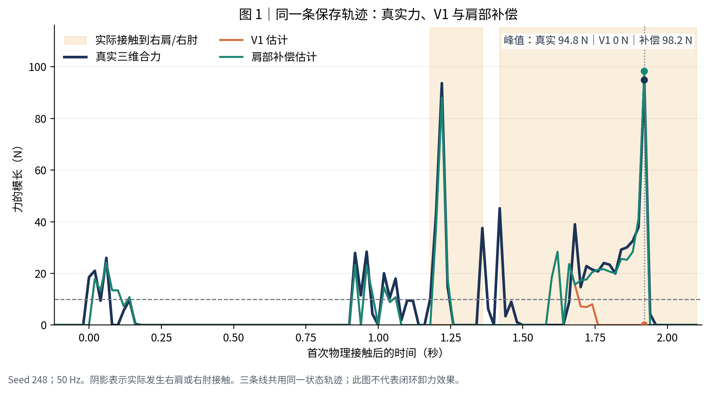
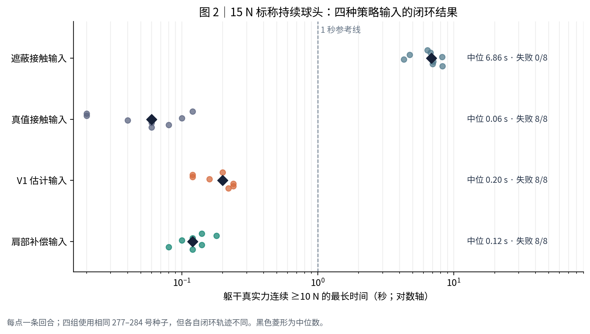
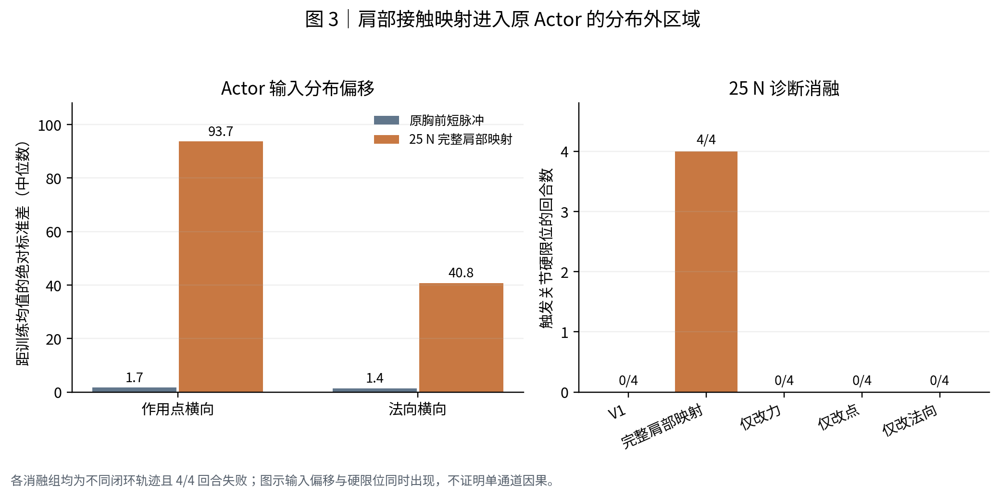

# Force estimator + SMP 联调进展（按师兄的步骤）

师兄给的路线是：先把状态变化接入 force estimator，比较真值力与估计力作为策略输入的差距；差距小时，在 EXP-022 checkpoint 上把真值力换成估计力继续 PPO；差距大时，先用这个 checkpoint 收集运动数据更新估计器。之后再由新策略采集数据、更新估计器，交替迭代。我这轮主要完成了第一步和第二步的条件检查。

## 第一步：接入状态，对比真值与估计输入

目前估计器读 50 Hz 的 10 帧本体观测和关节力矩历史，输出 `torso_link` 坐标系三维合力，再映射成 EXP-022 Actor 使用的接触标志、力比例、方向和作用点。推理只用可观测状态；真值力来自球头与机器人在仿真中的实际接触，用于评估。图中 15 N、20 N、25 N 是导轨的标称驱动力，实际接触峰值可能更高。

最初用 V1 对比时，运动中的主要问题是球头从胸前滑到右肩、右肘后，估计器仍按胸前接触处理，强峰值常被判成 0 N。20 N 持续球头的 8 个 V1 闭环回合里，真实峰值帧全部漏检。图 1 取一条封存的保存轨迹，把真值、V1 和后续肩部补偿放在**同一状态序列**上比较。真实峰值为 94.8 N，V1 输出 0 N，补偿后为 98.2 N；阴影是实际接触到右肩或右肘的时间段。它说明峰值漏检具体怎样出现，不代表闭环卸力已经成功。

因为第一步看到的差距很大，我按师兄给的分支，用 EXP-022 checkpoint 补采了运动回合，训练肩部接触迁移补偿。新分支只在高置信度肩部迁移且 V1 漏检时补三维力，其余帧保持 V1。模型冻结后，在 8 条独立保存轨迹上得到：

| 同轨迹指标 | V1 | 肩部补偿 |
| --- | ---: | ---: |
| 真实峰值帧漏检 | 6/8 | 0/8 |
| 受力回合三维向量误差中位数 | 22.39 N | 11.66 N |
| 最差回合三维向量误差 | 25.60 N | 21.01 N |
| 首次受力帧漏检 | 5/8 | 5/8 |
| 接触前 ≥10 N 误报回合 | 0/8 | 0/8 |

这一步解决了不少肩部峰值漏检，但还留着三个问题。第一，首次受力帧仍有 5/8 漏检，策略最需要及时响应的时刻没有改善。第二，候选只改原本漏检的帧；V1 已检出帧的方向不变，这些帧的平均方向误差仍为 29.85°。第三，在后续 15 N 估计输入闭环里，候选自己的 8 条轨迹还有 1 次峰值漏检和 1 次接触前误报：漏掉的是仅在躯干发生的单帧冲击，误报来自 V1 原输出。这说明肩部专用补偿还有覆盖边界，V1 原有误报也没有被它消除。[封存逐回合审核](evaluation/locked_offline_result.json)和[15 N 后续审核](evaluation/estimator_fresh15_result.json)保留了各回合结果；15 N 种子是在看过先前结果后用于诊断的，不另算封存测试。

## 第二步：检查现在能否把估计力换进去继续 PPO

我先把球头接触时间延长，检验策略在持续推压下能否使用真值输入。标称 15 N 的 277–284 号种子中，遮蔽接触输入的 8/8 回合都能安全持续受力，躯干真实力连续 ≥10 N 的最长片段中位数为 6.86 秒；真值、V1、肩部补偿输入的策略则各 8/8 失败，对应中位数只有 0.06、0.20、0.12 秒。图 2 每个点是一条回合；四组用相同种子，但闭环轨迹各自不同。这些终止包括自碰撞、工作区和关节硬限位，不能笼统写成“摔倒”。[真值/遮蔽审核](evaluation/oracle_gain_fresh_result.json)和[估计输入审核](evaluation/estimator_fresh15_result.json)给出了终止类型。

策略输入本身也有明显的分布偏移。EXP-022 原来主要按胸前短脉冲训练；25 N 诊断中，完整肩部映射的作用点横向通道离训练均值约 93.7 个标准差，法向横向约 40.8 个标准差。完整映射的 4/4 回合触发关节硬限位；只改力、只改点或只改法向时，硬限位均为 0/4，但这些设置仍全部失败。图 3 把输入偏移和消融结果并列；各组是不同闭环轨迹，不能据此把某一个通道认定为唯一原因。

还有训练目标的问题：原 EXP-022 的奖励和 `event_success` 对应球头短脉冲、卸力后回撤；持续推压协议下，原事件成功判据不能成立，沿用旧成功率也无法评价“持续受力时是否安全卸力”。所以现在不能只把真值换成估计力就继续 PPO。即使用真值接触输入，冻结 Actor 也还不能在这组持续加载条件下稳定运行。

下一步先另建持续球头任务，固定物理加载参数和独立验证种子，重新定义安全终止、实际受力时长、冲量/位移以及成功条件，再处理接触点和法向的归一化偏移。仓库里的 EXP-022 checkpoint 包含 Actor、Critic 和优化器状态；先从它用真值输入微调，真值策略通过独立闭环验收后，再替换为估计输入继续 PPO。这仍沿着师兄的第二步走。

## 第三步：策略与估计器联合迭代

等真值策略和估计输入策略都能稳定通过持续接触测试，再用新策略采集的运动回合更新估计器，固定新估计器微调策略，按这个顺序交替验证。当前尚未进入这一步，也没有持续卸力成功的证据。

肩部补偿作为可加载实验候选放在 `qc-1/smp` 的 `integration/force` 分支，默认仍使用 V1。模型、图、绘图数据和逐回合记录都在 [EXP-022 肩部补偿实验包](https://github.com/qc-1/smp/tree/integration/force/force/exp022_shoulder_rescue_v1)。
